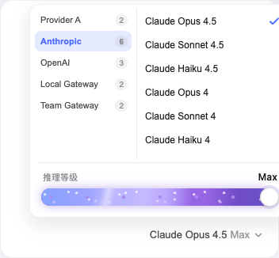
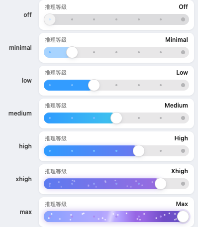

# dsh-reasoning-slider

**两层模型选择器 + 内嵌推理等级滑块**，直接接管 DeepSeek Harness 的模型选择席位：左栏选提供商（Provider），右栏选具体模型，选中模型后弹层底部出现滑块，拖动即可切换该模型的推理档位（off / minimal / low / medium / high / xhigh / max）。



## 安装

需要 pnpm（`npm i -g pnpm`）与 dsh（`npm i -g @deepseek-ai/dsh`）。

```sh
dsh plugin --profile web add reasoning-slider
```

> 桌面客户端（DeepSeek Harness App）的 desktop profile 只能走应用内的插件页 / 插件市场安装。

## 功能

### 两层选择

- **第一层 · 提供商**：左栏列出全部提供商，每项带模型数量徽标；当前模型所属提供商默认高亮并选中。
- **第二层 · 模型**：右栏只显示选中提供商的模型，不再重复显示提供商名称。
- 模型行**只显示模型名**；目录里的模型描述不占第二行，改为悬停提示（`模型名 · 描述`）。
- 两栏**各自独立滚动**，提供商或模型变多都不会把弹层撑成一长条。
- 当前模型带 ✓ 标记，切换提供商后再切回来仍定位到它。

### 弹层尺寸恒定

- 弹层**整体固定尺寸**（宽 `min(320px, 100vw - 32px)`、高 `min(260px, 100vh - 96px)`），切换提供商、切换模型都不会改变大小。
- 模型超出可视区域时**由右栏自己滚动**，不会把弹层撑高。
- 打开弹层时会在后台静默重新读取目录，但**不会显示刷新提示、也不会挤动列表** —— 「正在刷新模型列表…」只在冷启动（列表还没有任何内容）时出现。
- 推理等级区块固定 60px 高且**始终渲染**：模型没有推理元数据时显示「—」与提示文字，而不是整块消失。
- 因此从 6 个模型的提供商切到 2 个模型的提供商，弹层不会跳一下。

### 推理等级滑块

- 滑块内嵌于弹层底部，显示当前模型支持的推理档位。
- 拖动滑块实时预览，松开后生效。
- 切换模型时自动携带当前档位；目标模型不支持当前档位时自动回退到其默认档位。
- 单档位模型显示"支持档位: xxx"，无档位模型显示提示。
- 键盘：←/→ 或 ↑/↓ 切换，滚动滚轮也可切换。

### 档位视觉分级

**每个档位都有自己的配色和动效额度**，滑块因此读起来是一条"档位轴"，而不是"到 max 之前一直是蓝的"。



| 档位 | 填充 | 动效 |
|---|---|---|
| `off` | 无填充（轨道变暗、圆点半透明） | 无 |
| `minimal` | 浅蓝 `#A8D4FF` | 无 |
| `low` | 标准蓝 `#339CFF` | 无 |
| `medium` | 蓝→青渐变 | 慢速掠光 4.2s |
| `high` | 蓝→靛渐变 + 外发光 | 中速掠光 3.0s |
| `xhigh` | 靛→紫渐变 + 更强外发光 | 快速掠光 2.2s + 稀疏粒子 1.7s |
| `max` | 完整紫渐变 | 高速粒子 0.98s + 高光扫过 + 到达瞬间爆闪 |

**分级依据是档位的 `id`，不是序号。** `off / minimal / low / medium / high / xhigh / max` 按语义映射；因此一个最高只到 `high` 的模型（例如只提供 `off/low/medium/high` 的适配器），顶格也只是 `high` 的样子，不会假装成 max。

适配器用了自定义档位名（非上述词汇）时，退化为**按序号排名**分配：最低档 → `off`，最高档 → `max`，中间按比例落到 `low/medium/high/xhigh`。

所有动效在系统开启**减少动态效果**（`prefers-reduced-motion`）时自动关闭，只保留静态配色。

### 通用

- **Esc** 直接关闭弹层。
- 点击弹层外部、或焦点离开弹层即关闭。
- 会话被锁定时选择席位不可点击。
- 子代理（addressed subagent）会话不显示该席位。

## 卸载

```sh
dsh plugin --profile web remove reasoning-slider
```

## 兼容性

`reasoning-slider@0.1.0` 支持 DSH `0.2.0-rc.2`、`0.1.2-alpha.2`、`0.1.2-alpha.4`、`0.1.2-alpha.5` 与 `0.1.2-rc.1`，要求 Node.js `22.13.0` 或更高版本。DSH `0.1.2-alpha.3` 尚未验证。

## 版本历史

- **0.1.0**
  - 🔥 模型选择改为**两层**：左栏 Provider、右栏模型，两栏独立滚动
  - ✨ 弹层改为**固定高度**，切换 Provider / 模型不再跳动
  - 🔤 弹层内字体整体缩小一档（模型名 14→12px、Provider 行 12→11px 等）
  - 🐛 右栏不再重复显示 Provider 名称
  - ✅ 声明 DSH `0.2.0-rc.2` 兼容
- **0.0.6** 及更早：单层分组列表 + 推理滑块

## 开发

```text
dsh-reasoning-slider/
├── lib/
│   ├── index.js   # Node half（纯 UI 插件，apply 为空）
│   └── client.js  # 浏览器 half（两层选择器 + 推理滑块）
├── cordis.patch.yml
└── package.json   # dsh.bundle 声明：安装后自动成为 profile 层
```

客户端代码是 `window.__ModuleLoader__.load({...})` 格式的普通 JavaScript，无构建步骤；React 通过 `require("react")` 从 dsh 运行时解析。

### 本地调试

**用本地路径安装（推荐）** —— 装出来是**软链**，改完源码只要重载窗口，不用反复拷贝。

1. 先在 Plugins 页**卸载**已有的 `reasoning-slider`（同名已安装会被拒绝，报 `already-installed`）
2. Plugins 页 → **Add plugin** → 填本仓库的**绝对路径**：

   ```
   /absolute/path/to/dsh-reasoning-slider
   ```

3. 之后改 `lib/client.js`，重载 DSH 窗口即生效

```sh
# 确认装的是软链而不是拷贝：
ls -ld ~/.dsh/profiles/<profile>/node_modules/reasoning-slider
# → ... -> /absolute/path/to/dsh-reasoning-slider
```

注意事项：

- 路径必须**绝对**；`file:` / `link:` 前缀可选
- 该目录需有 `package.json`，且含 `name` 与 `dsh.bundle`（本仓库都有）
- 软链指向源码目录，**别移动或重命名该目录**，否则链接失效
- 只有改动 `package.json` 的元数据（版本号、`dsh` 声明）才需要卸载重装；改 `lib/client.js` 不需要

如果不用路径安装，也可以每次手动覆盖后重载：

```sh
cp lib/client.js ~/.dsh/profiles/desktop/node_modules/reasoning-slider/lib/client.js
```

## 许可

MIT
